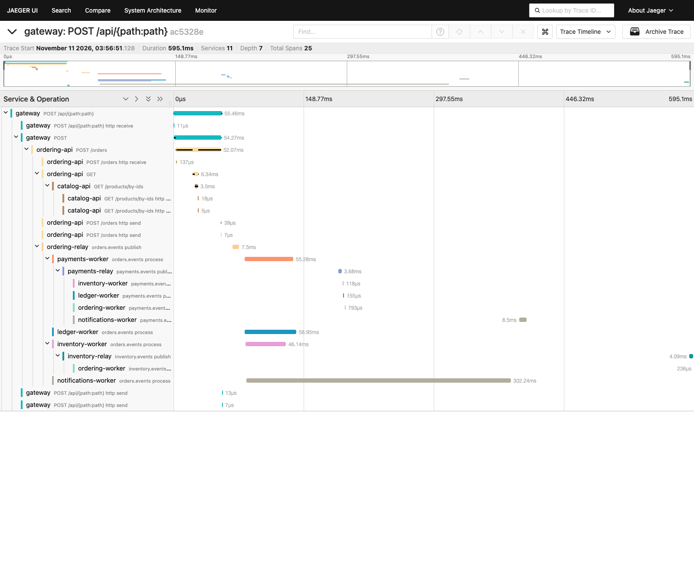
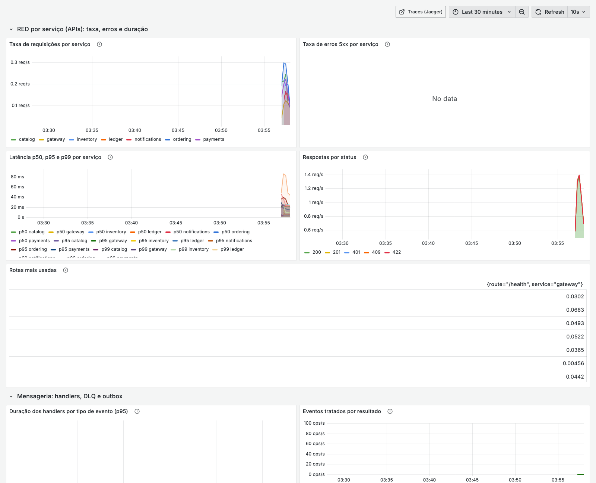

# Marketplace PIX

Projeto de estudo: marketplace com checkout PIX em **microsserviços** (Python) e frontend em React.
Objetivo: praticar o que vagas de backend sênior pedem (FastAPI, SQLAlchemy, Celery, Docker, Kubernetes, Azure, RAG e agentes).

> Projeto de estudo. Não processa dinheiro real. O PIX roda contra um PSP simulado e, depois, contra sandbox.

## O que vamos construir

Lojistas vendem, clientes compram, o PIX cobra e o ledger registra o dinheiro.
Cada serviço tem seu próprio banco e se comunica com os outros por eventos.

```
Cliente (React) -> Gateway
                      |
   +--------+---------+---------+----------+---------------+
   |        |         |         |          |               |
Catalog  Ordering  Payments  Ledger   Inventory      Notifications
                      \________ Event bus (Kafka) ________/
```

| Serviço | Responsabilidade | Destaque de aprendizado |
|---|---|---|
| ordering | Pedido e orquestração da saga | DDD, outbox, saga |
| payments | Cobrança PIX, PSP, webhook | inbox, idempotência, webhook seguro |
| ledger | Livro-razão de dupla entrada, split | ACID, consistência sob concorrência |
| inventory | Estoque e reserva com TTL | concorrência, Redis |
| catalog | Produtos e busca | CRUD, pgvector (RAG depois) |
| notifications | E-mail e avisos | Celery |

## Conceitos praticados

ACID por caso de uso (Unit of Work), outbox, inbox, idempotência (`Idempotency-Key`),
SOLID, DDD (onde o domínio é rico), Clean Architecture, saga por orquestração.

## Estrutura

```
marketplace-pix/
  backend/
    services/        um diretório por microsserviço (cada um com pyproject, Dockerfile, testes)
    libs/            código compartilhado mínimo (outbox relay, inbox, eventos)
    gateway/         ponto de entrada da API
  frontend/          React + Vite + TypeScript
  infra/             docker-compose, init dos bancos, depois Terraform e Helm
  docs/              arquitetura e decisões (ADRs)
```

Estrutura interna de cada serviço (Clean Architecture):

```
services/<nome>/
  src/<nome>/
    domain/            regras puras, sem framework
    application/       casos de uso, portas (interfaces)
    infrastructure/    SQLAlchemy, mensageria, adapters
    interface/         rotas FastAPI e schemas
  tests/{unit,integration}
  Dockerfile
  pyproject.toml
```

Regra de dependência: `interface -> application -> domain`; `infrastructure` depende de `application` e `domain`. O `domain` não importa nada de fora.

## Stack

- Backend: Python 3.13, uv, FastAPI, SQLAlchemy 2 async, Alembic, Pydantic v2, Celery, pytest + Testcontainers, ruff, mypy
- Dados e mensageria: PostgreSQL (um banco por serviço), Redis, Kafka (KRaft)
- Frontend: React, Vite, TypeScript, TanStack Query, React Hook Form + Zod, Tailwind, Vitest, Playwright
- Infra: Docker, Docker Compose, k3d + Helm, Terraform, Azure Container Apps, GitHub Actions
- Observabilidade: OpenTelemetry, Prometheus, Grafana

## Rodando a infraestrutura local

```bash
cp .env.example .env
docker compose -f infra/docker-compose.yml --env-file .env up -d
```

| Item | Endereço padrão |
|---|---|
| PostgreSQL | localhost:5433 (usuário e senha no `.env`) |
| Kafka (broker) | localhost:9094 |
| Kafka UI | http://localhost:8081 |
| Redis | localhost:6380 |

### Atalhos (scripts)

```bash
scripts/up.sh      # cria o .env se faltar, sobe tudo (com build) e espera ficar saudável
scripts/e2e.sh     # teste de ponta a ponta pelo gateway (autenticação, isolamento e saga feliz), repetível
scripts/e2e-saga.sh  # pagamento que nunca chega e pagamento tardio (suba com SAGA_TIMEOUT_SECONDS=12)
scripts/reset.sh   # apaga containers e volumes para recomeçar do zero
```

### Assistente de compras (RAG com modelos simulados)

O botão do assistente fica no canto da loja (ou `Ctrl /`). A resposta chega em streaming, cita produtos e mostra o
rastro: ferramentas chamadas, trechos recuperados com a pontuação e o tempo.


### Segurança

Login com JWT de 10 minutos e refresh rotativo, papéis `customer`, `merchant` e `admin`, autorização por objeto e
isolamento entre lojistas. Contas de desenvolvimento: `admin@marketplace-pix.local` e um lojista por loja
(`aurora-tech@`, `casa-lume@`, `trilha-sports@marketplace-pix.local`), todos com o valor de `IDENTITY_SEED_PASSWORD` do
`.env`. Detalhes em `docs/SEGURANCA.md`, `docs/CONTRATOS.md` e `docs/adr/0001-identidade-como-servico.md`. Evolução de
eventos em `docs/EVOLUCAO-DE-EVENTOS.md`.

### Observabilidade (opcional)

`scripts/up.sh --obs` liga Prometheus, Grafana e Jaeger. O Jaeger mostra **um único trace por pedido**, atravessando
gateway, ordering, catalog, o relay, o Kafka e os workers de payments, inventory, ledger e notifications.
O contexto do trace viaja gravado na linha do outbox e nos headers das mensagens.




Reprocessar mensagens da DLQ: `uv run python -m marketplace_common.dlq list --topic orders.events.dlq`
(veja `backend/libs/marketplace_common/README.md`).

### Subindo os serviços

```bash
docker compose -f infra/docker-compose.yml --env-file .env --profile services up -d --build
```

| Serviço | O que é | Endereço |
|---|---|---|
| ordering-api | FastAPI: `POST /orders` (exige `Idempotency-Key`), `GET /orders/{id}`, `/health`, `/ready` | http://localhost:8001/docs |
| ordering-relay | publica o outbox no Kafka | (sem porta) |
| ordering-worker | consome `payments.events` (com inbox): marca pago ou cancela o pedido | (sem porta) |
| assistant-api | assistente de compras (RAG + agente, modelos simulados) | http://localhost:8007/docs |
| identity-api | cadastro, login, JWT EdDSA, refresh rotativo e JWKS (`/api/auth/*`) | http://localhost:8008/docs |
| frontend | loja "Praça" (React), com proxy `/api` para o gateway | http://localhost:5173 |
| gateway | ponto de entrada único da API (`/api/...`), CORS, limite de requisições | http://localhost:8000/docs |
| catalog-api | produtos, busca, categorias | http://localhost:8003/docs |
| inventory-api / -worker / -relay | estoque, reservas e liberação por eventos | http://localhost:8004/docs |
| ledger-api / -worker / -relay | livro-razão, split e conciliação | http://localhost:8005/docs |
| notifications-api / -worker / -celery / -beat | e-mails transacionais (Celery + Mailpit) | http://localhost:8025 (e-mails) |
| payments-api | webhook do PSP (HMAC), `GET /payments/by-order/{id}`, rota dev do PSP simulado | http://localhost:8002/docs |
| payments-worker | consome `orders.events` (com inbox) e expira cobranças | (sem porta) |
| payments-relay | publica o outbox do payments em `payments.events` | (sem porta) |
| ordering-migrate | roda `alembic upgrade head` e termina | (one-shot) |

Testes de um serviço: `cd backend/services/<ordering|payments> && uv run pytest` (a infra precisa estar de pé).

## Roadmap

Veja [docs/ROADMAP.md](docs/ROADMAP.md) para as fases e o que atacar primeiro, e
[docs/ARQUITETURA.md](docs/ARQUITETURA.md) para o desenho completo.
