**English** | [Português (Brasil)](README.pt-BR.md)

<div align="center">

# Marketplace PIX

**An event-driven marketplace with PIX checkout, built the way a production platform is built.**
Nine Python microservices, a React storefront, a merchant console and a RAG shopping assistant, with the reliability, security and observability work that usually gets skipped.

[](https://github.com/hengtan/marketplace-pix/actions/workflows/ci.yml)


</div>

> A learning and portfolio project. It never touches real money: PIX (Brazil's instant payment system) runs against a simulated payment service provider behind a port, and the AI models are simulated behind interfaces. Everything else is real and runs end to end on your machine.

## Contents

[At a glance](#at-a-glance) · [Product tour](#product-tour) · [Architecture](#architecture) · [How an order flows](#how-an-order-flows) · [Reliability patterns](#reliability-patterns) · [Security](#security) · [Merchant lifecycle](#merchant-lifecycle) · [AI assistant](#ai-assistant-rag-and-agent) · [Observability](#observability) · [Testing and quality](#testing-and-quality) · [Patterns and decisions](#patterns-and-decisions) · [Repository layout](#repository-layout) · [Quick start](#quick-start) · [Documentation](#documentation) · [Limitations](#known-limitations)

## At a glance

| | |
|---|---|
| **Services** | `ordering`, `payments`, `inventory`, `ledger`, `notifications`, `catalog`, `assistant`, `identity`, plus an API gateway. Each owns its database and talks to the others through events. |
| **Consistency** | Transactional outbox, idempotent inbox, `Idempotency-Key`, choreographed saga with a global timeout and refund of late payments, double-entry ledger in integer cents. |
| **Resilience** | Circuit breaker, retry with full jitter and a retry budget, deadline propagation, bulkhead, distributed rate limit, dead-letter queues. Proved by a chaos script that kills services on the live stack. |
| **Security** | EdDSA JWT with JWKS, rotating refresh tokens with reuse detection, signed identity propagation, object-level authorization, tenant isolation, token revocation. |
| **Observability** | One OpenTelemetry trace per order across Kafka (26 spans over 11 services, about 650 ms), RED metrics, three Grafana dashboards with SLO burn-rate alerts. |
| **AI** | Hybrid retrieval (pgvector plus full text, fused with RRF), query understanding, semantic cache, tool-using agent, 41 red-team attacks contained, a 111-case evaluation that gates the build. |
| **Quality** | 1,650+ automated tests, 181 end-to-end checks on the live stack, strict typing in Python and TypeScript, 20 CI jobs. |

## Product tour

<table>
<tr>
<td width="50%"><br><sub><b>Storefront.</b> Generated product art (zero image weight), live stock, add-to-cart with a flying item animation.</sub></td>
<td width="50%"><br><sub><b>PIX checkout.</b> QR code, real countdown ring and a live order timeline that updates as events arrive.</sub></td>
</tr>
<tr>
<td><br><sub><b>Merchant console.</b> KPIs with period-over-period change, rolling average and actionable alerts, fed by the double-entry ledger.</sub></td>
<td><br><sub><b>Stock.</b> Coverage bars from sales rate, inline editing with optimistic update and rollback, critical items surfaced first.</sub></td>
</tr>
<tr>
<td><br><sub><b>Orders.</b> Live queue with status filters, detail drawer and a toast when a sale lands.</sub></td>
<td><br><sub><b>Assistant.</b> Streaming answers with numbered citations, product cards and a "how I got this answer" trace.</sub></td>
</tr>
</table>

<details>
<summary>More screens: products tab, statement, dark theme, mobile</summary>

<table>
<tr>
<td width="50%"></td>
<td width="50%"></td>
</tr>
<tr>
<td></td>
<td align="center"></td>
</tr>
</table>

</details>

The storefront targets Brazil, so the UI copy is Brazilian Portuguese. Code, comments and documentation are English.

## Architecture

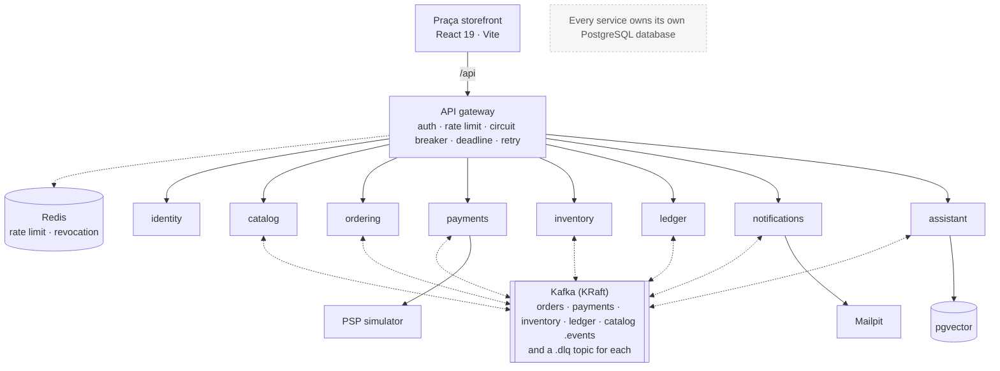

| Service | Port | Responsibility | Patterns it exercises |
|---|---|---|---|
| `gateway` | 8000 | Single entry point: routes, auth, rate limit, resilience, aggregated health | Reverse proxy, circuit breaker, bulkhead, deadline propagation, SSE streaming |
| `identity` | 8008 | Sign-up, login, tokens, roles | argon2id, EdDSA JWT and JWKS, refresh rotation with reuse detection |
| `catalog` | 8003 | Products, search, merchant write API | Accent-insensitive search, ETag revalidation, outbox publisher |
| `ordering` | 8001 | Orders and saga timeout | DDD aggregate, Unit of Work, outbox, `Idempotency-Key`, process manager |
| `payments` | 8002 | PIX charges, PSP webhook, refunds | Inbox, HMAC webhook that re-checks the PSP, fail-closed, resilient PSP client |
| `inventory` | 8004 | Stock and reservations | All-or-nothing reservation with TTL, `FOR UPDATE`, deterministic lock order |
| `ledger` | 8005 | Merchant balances and statements | Double-entry bookkeeping, money as integer cents, reconciliation |
| `notifications` | 8006 | Customer emails | Celery with retry, sweeper, daily digest |
| `assistant` | 8007 | Shopping assistant | RAG, hybrid retrieval, agent loop, semantic cache, guardrails |
| `frontend` | 5173 | Storefront and merchant console | TanStack Router and Query, Motion, MSW, Playwright |

The API contract, event catalog, ports and seed data live in one place: [`docs/CONTRACTS.md`](docs/CONTRACTS.md). The longer design notes are in [`docs/ARCHITECTURE.md`](docs/ARCHITECTURE.md).

## How an order flows

No service is called synchronously on the write path. The order is accepted in one local transaction, and everything else reacts to events.

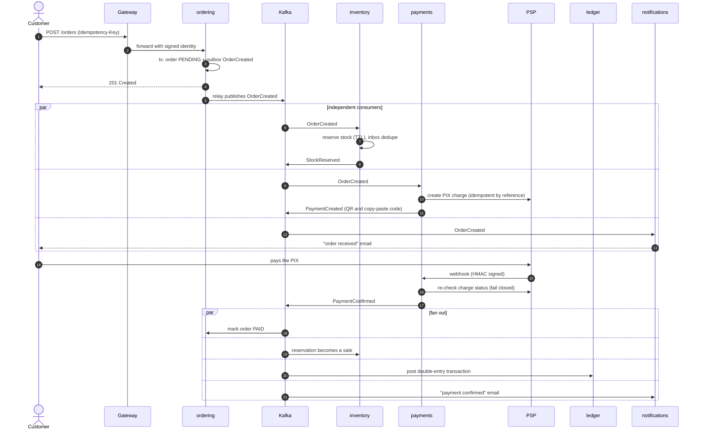

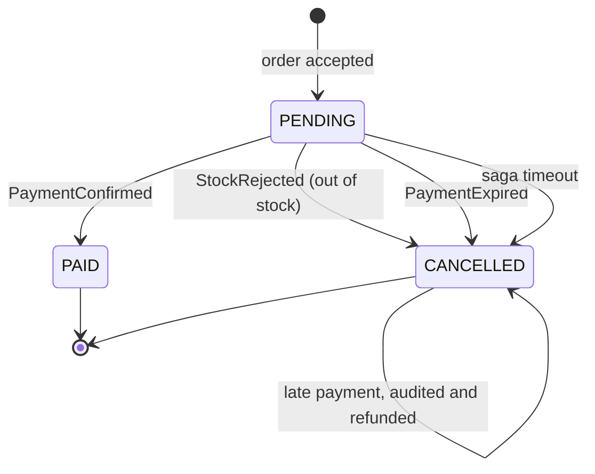

Failure paths compensate through events instead of distributed transactions: a stock rejection cancels the order, which cancels the pending charge and releases the reservation. A payment that arrives after the order was cancelled is recorded in an audit table and refunded at the PSP, reversed in the ledger and returned to stock, all idempotently. The saga timeout cancels any order stuck in `PENDING`.

## Reliability patterns

### Outbox, inbox and idempotency

There is no transaction that spans a database and a broker, so the system never tries to write to both.

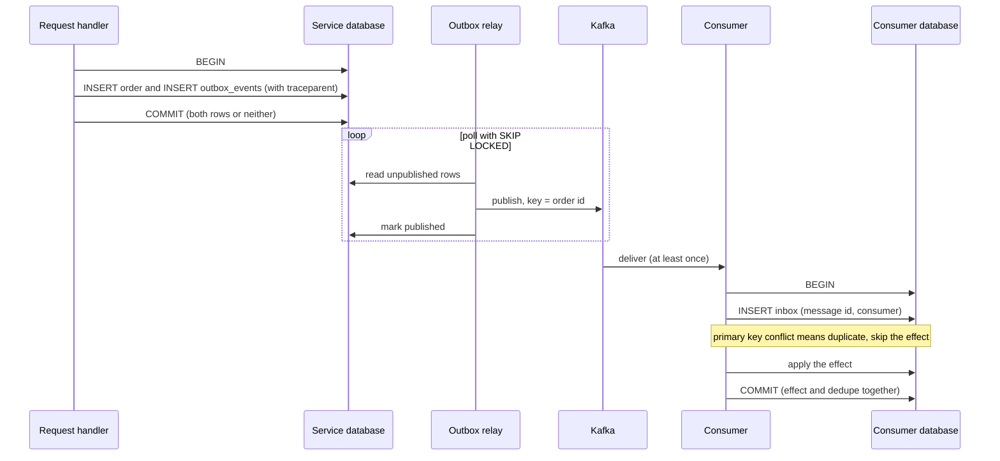

- **Outbox:** the event is written in the same transaction as the data, then a relay publishes it. The row carries the W3C `traceparent`, so traces survive the hop through Kafka.
- **Inbox:** consumers claim `(message_id, consumer)` in the same transaction as their effect, so redelivery is harmless.
- **`Idempotency-Key`:** claimed with `INSERT ... ON CONFLICT DO NOTHING` inside the order transaction. Five identical concurrent requests create one order (covered by an integration test).
- **Poison messages:** consumers retry a bounded number of times, then route to `<topic>.dlq` with the reason and origin. A tool replays them, dry run by default, with loop protection.
- **Event evolution:** every event has a `schema_version`, one model per version, upcasters, and golden files that fail the build if a producer changes a shape by accident. See [`docs/EVENT-EVOLUTION.md`](docs/EVENT-EVOLUTION.md).

### Surviving dependency failures

Every call the gateway makes to an upstream passes through the same pipeline.

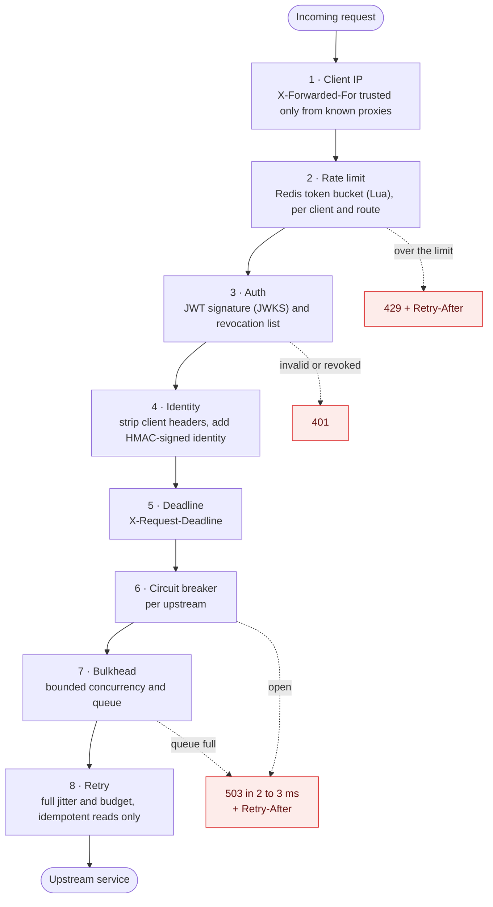

| Pattern | What it protects against | Where |
|---|---|---|
| Circuit breaker (sliding window, slow calls, half-open probes) | A sick dependency soaking up every worker | Gateway per upstream, PSP client, LLM and embedder |
| Retry with full jitter and a retry budget | Transient errors, without a retry storm | Idempotent reads and PSP calls only |
| Deadline propagation | Slow chains that outlive the caller | `X-Request-Deadline` honored hop by hop |
| Bulkhead | One dependency using all the concurrency | Gateway and PSP client |
| Distributed rate limit | Abuse, with one bucket shared across replicas | Gateway, plus login and sign-up |
| Graceful degradation | Total failure when a part is down | Structured 503, assistant falls back to plain search |

The chaos script (`scripts/chaos.sh`) stops `catalog`, `payments` and `redis` on the live stack and checks 40 things: the breaker opens, responses fail fast, the system recovers by itself, and orders created before and during the outage still reach `PAID`. With Redis down the gateway kept answering (30 of 30 requests, p50 12 ms). Details and the Polly equivalents for .NET readers are in [`docs/RESILIENCE.md`](docs/RESILIENCE.md).

<table>
<tr>
<td width="50%"><br><sub>Resilience dashboard: breaker state, transitions and fail-fast rejections during the chaos run.</sub></td>
<td width="50%"><br><sub>Event topics and their dead-letter queues in Kafka UI.</sub></td>
</tr>
</table>

## Security

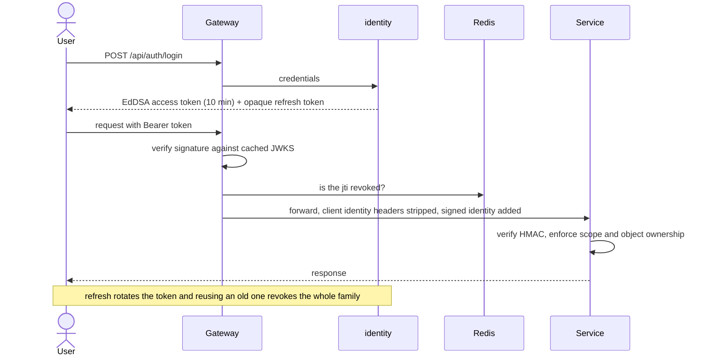

- **Identity as a service** (decision record in [`docs/adr`](docs/adr/0001-identity-as-a-service.md)): the gateway only ever holds the public key.
- **Anti-spoofing:** the gateway deletes any `X-User-*` header sent by a client and injects an HMAC-signed identity bound to the request id and a 60 second window, because service ports are reachable on the host.
- **Object-level authorization:** someone else's order answers `404`, identical to a missing one, so existence does not leak. Merchants see only their own ledger, stock and orders, with isolation tests between two merchants.
- **Abuse controls:** progressive backoff on login and sign-up per IP and per email, body size limit, security headers, token revocation on logout and on refresh reuse (effective in under a second).
- **Threat model:** STRIDE and the OWASP API Top 10 are mapped to concrete controls and tests in [`docs/SECURITY.md`](docs/SECURITY.md), including what is not covered.

## Merchant lifecycle

The merchant console exercises the whole system from product creation to money in the ledger, and an end-to-end script verifies each step.

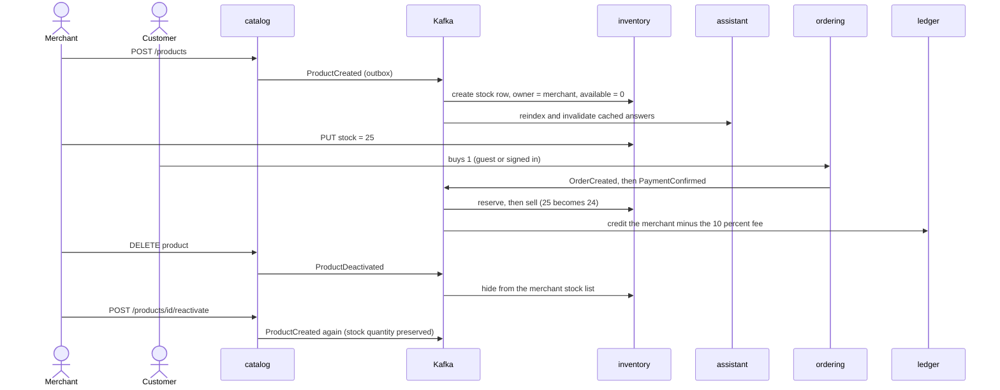

Catalog reads revalidate on every request (ETag, `max-age=0, must-revalidate`) and the owner list is `no-store`, so an edit, a new product or a deactivation is visible immediately. This was found the hard way: `curl` has no cache, a browser does.

## AI assistant (RAG and agent)

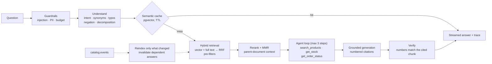

Evaluation runs on a 111-case golden set (adversarial, negation, typos, multi-hop, holdout) and a regression gate in CI fails the build when a metric drops below its threshold.

| Metric | Baseline | Production pipeline |
|---|---|---|
| hit@3 | 0.923 | **0.962** |
| MRR | 0.870 | **0.952** |
| nDCG@5 | 0.861 | **0.942** |
| Negation ("not X") handled | 0.000 | **1.000** |
| Semantic cache hit rate | n/a | 75% over 107 questions |
| Red-team attacks contained | n/a | 41 of 41 |

> Honest caveat: embeddings are hashing-based and the LLM is deterministic, so these numbers are a regression net for retrieval quality, not a statement about model quality. Ollama adapters are implemented and tested against a fake server. See [`docs/RAG-EXPLAINED.md`](docs/RAG-EXPLAINED.md) (with 15 interview questions) and [`docs/RAG-EVALUATION.md`](docs/RAG-EVALUATION.md).

## Observability

<table>
<tr>
<td width="50%"><br><sub>One trace per order: 26 spans across 11 services in 648 ms, crossing Kafka through the stored <code>traceparent</code>.</sub></td>
<td width="50%"><br><sub>RED metrics per service, handler durations, DLQ and outbox backlog.</sub></td>
</tr>
<tr>
<td><br><sub>Assistant: per-stage latency, tokens and estimated cost, cache hit rate.</sub></td>
<td><br><sub>Transactional emails sent through Celery, captured by Mailpit.</sub></td>
</tr>
</table>

Logs are structured JSON with `trace_id`. Metrics are Prometheus (RED plus business counters). Alerts include SLO burn-rate rules checked with `promtool test rules`.

## Testing and quality

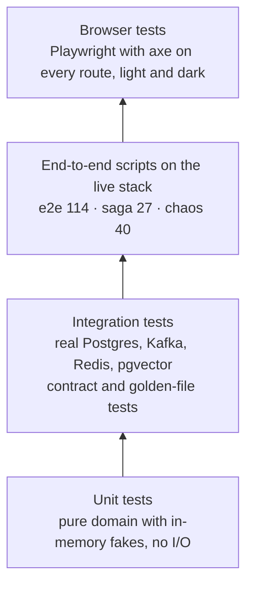

| Layer | What | Count |
|---|---|---|
| Backend unit and integration | 9 Python services plus a shared library, ruff, strict mypy | 1,425 |
| Frontend unit | Vitest, Testing Library, MSW | 172 |
| Frontend end to end | Playwright with axe (WCAG), reduced motion, every merchant tab | 60 |
| Live-stack scripts | `scripts/e2e.sh` (auth, IDOR, tenant isolation, merchant lifecycle, idempotency), `scripts/e2e-saga.sh` (payment that never arrives, late payment refunded), `scripts/chaos.sh` | 181 checks |
| Load test | `scripts/loadtest.py`, results in [`docs/LOAD-TEST.md`](docs/LOAD-TEST.md) | n/a |

Practices that matter more than the counts:

- **Tests first for the hard parts:** concurrency (100 reservations for 10 units accept exactly 10, 50 simultaneous payments keep the ledger exact, a property test checks the books always balance), idempotency, and every failure path.
- **Contracts are tested, not assumed:** golden files per event version, consumer compatibility tests, and a single source of truth for routes and events.
- **Flaky tests are bugs:** animation-aware assertions, generous async timeouts, and a stress run of the whole suite in parallel before trusting a green result.
- **Mocks do not prove contracts:** several integration bugs only appeared against the real backend (a `warning: null` the mock never sent, a guest id the server correctly rejected, an unprotected refund call). Every integration now runs the three live-stack scripts and a real-browser pass.
- **CI:** 20 jobs per push.

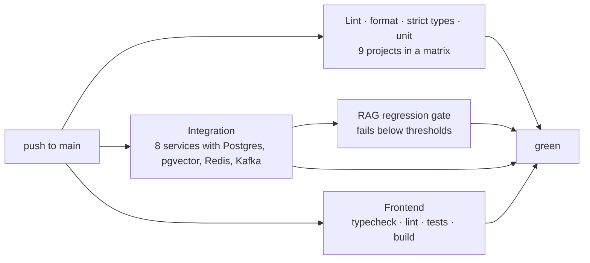

## Patterns and decisions

| Pattern or decision | Where | Why |
|---|---|---|
| Clean Architecture, ports and adapters (`Protocol`) | Every service | The domain has no framework imports and is tested with in-memory fakes |
| DDD aggregates, value objects | `ordering`, `payments`, `inventory` | Invariants live in one place (for example `Money` in cents, no floats) |
| Unit of Work | Every service | One transaction per use case |
| Transactional outbox and idempotent inbox | Producers and consumers | Reliable events without distributed transactions |
| Choreographed saga with a process manager for deadlines | Order flow | Loose coupling, with visibility from distributed traces |
| Pessimistic locking with deterministic order | `inventory`, `ordering` | No deadlocks, no overselling |
| Microservices with a database per service | Whole system | Practice real distributed problems. A small team would start as a modular monolith and extract by need |
| Kafka over a plain queue | Event bus | Replay, ordering per key, multiple consumers |
| Identity as its own service | `identity` | Isolates credentials and keys ([ADR 0001](docs/adr/0001-identity-as-a-service.md)) |
| Fail closed | Webhook, gateway auth | When unsure, deny and stay pending rather than approve |
| Composition root in `main.py` | Every service | Dependency injection by hand, easy to read and test |

## Repository layout

```text
marketplace-pix/
├── backend/
│   ├── gateway/                  reverse proxy: auth, rate limit, resilience
│   ├── libs/marketplace_common/  consumer + DLQ, outbox relay, resilience, security, observability
│   └── services/
│       ├── ordering/ payments/ inventory/ ledger/
│       └── notifications/ catalog/ assistant/ identity/
├── frontend/                     React storefront and merchant console
├── infra/                        docker compose, observability stack (Prometheus, Grafana, Jaeger)
├── scripts/                      up.sh · e2e.sh · e2e-saga.sh · chaos.sh · loadtest.py · reset.sh
├── docs/                         architecture, contracts, security, resilience, RAG (English), pt-BR/ (Portuguese)
└── .github/workflows/ci.yml
```

Inside each service, dependencies only point inward:

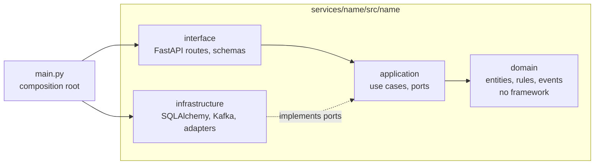

## Quick start

Prerequisites: Docker with about 8 GB of memory available. To run the test suites you also need [uv](https://docs.astral.sh/uv/) and [pnpm](https://pnpm.io/).

```bash
git clone https://github.com/hengtan/marketplace-pix.git
cd marketplace-pix
scripts/up.sh --obs        # builds and starts everything, then waits until the gateway is healthy
scripts/e2e.sh             # 114 checks across the live stack
```

| What | URL |
|---|---|
| Storefront | http://localhost:5173 |
| API docs (gateway) | http://localhost:8000/docs |
| Merchant console | http://localhost:5173/lojista |
| Mailpit (emails) | http://localhost:8025 |
| Kafka UI | http://localhost:8081 |
| Jaeger (traces) | http://localhost:16686 |
| Grafana (dashboards) | http://localhost:3000 (admin / admin) |

**Development accounts** (created by the seed, development only): `trilha-sports@marketplace-pix.local`, `aurora-tech@marketplace-pix.local`, `casa-lume@marketplace-pix.local` (merchants) and `admin@marketplace-pix.local`, all with password `praca1234`. Customers can also check out as a guest or register at `/cadastro`.

| Script | Purpose |
|---|---|
| `scripts/up.sh [--obs]` | Create `.env`, build, start, wait for health (`--obs` adds Prometheus, Grafana, Jaeger) |
| `scripts/e2e.sh` | Auth, IDOR, tenant isolation, purchase, idempotency, merchant lifecycle |
| `scripts/e2e-saga.sh` | Payment that never arrives, late payment refunded (run with `SAGA_TIMEOUT_SECONDS=12 SAGA_SWEEP_INTERVAL_SECONDS=3`) |
| `scripts/chaos.sh` | Stops catalog, payments and Redis, then verifies recovery |
| `scripts/loadtest.py` | Asyncio load test with p50, p95, p99 and 429 rate |
| `scripts/reset.sh` | Wipe volumes and start clean |

Run a service's tests:

```bash
cd backend/services/ordering && uv run pytest        # unit + integration (needs the infra containers)
cd frontend && pnpm install && pnpm test && pnpm e2e  # unit, then Playwright with mocks
```

## Documentation

| Document | Contents |
|---|---|
| [`docs/ARCHITECTURE.md`](docs/ARCHITECTURE.md) | Flows, saga, patterns, key tables, Clean Architecture |
| [`docs/CONTRACTS.md`](docs/CONTRACTS.md) | Ports, REST contracts, event catalog, access matrix, seed data |
| [`docs/RESILIENCE.md`](docs/RESILIENCE.md) | Each pattern, when to use it, trade-offs, chaos and load results |
| [`docs/SECURITY.md`](docs/SECURITY.md) | Threat model (STRIDE), OWASP API Top 10 mapping, limitations |
| [`docs/EVENT-EVOLUTION.md`](docs/EVENT-EVOLUTION.md) | Versioning, upcasters, golden files |
| [`docs/RAG-EXPLAINED.md`](docs/RAG-EXPLAINED.md) · [`docs/RAG-EVALUATION.md`](docs/RAG-EVALUATION.md) | The pipeline, why each technique exists, measured results |
| [`docs/LOAD-TEST.md`](docs/LOAD-TEST.md) | Load test method and results |
| [`docs/ROADMAP.md`](docs/ROADMAP.md) | What is delivered and what is not |
| [`frontend/docs/DESIGN.md`](frontend/docs/DESIGN.md) | Visual identity, motion, performance, accessibility |
| Service READMEs | [`assistant`](backend/services/assistant/README.md) · [`marketplace_common`](backend/libs/marketplace_common/README.md) · [`frontend`](frontend/README.md) |

Every document has a Portuguese (Brasil) translation in a `pt-BR` folder or next to it as `README.pt-BR.md`, linked from the first line of each file.

## Known limitations

Stated plainly, because knowing what is missing is part of the job. The full list is in [`docs/ROADMAP.md`](docs/ROADMAP.md).

- AI models are simulated. The pipeline, evaluation and guardrails are real; swapping in Ollama or a hosted model is the next step.
- The PSP is simulated behind a port. A real integration needs sandbox credentials and daily reconciliation.
- No Azure, Terraform, Kubernetes or Helm yet. Everything runs on Docker Compose.
- No MFA or email verification, and the refresh token travels in the response body (the production answer is an `HttpOnly` cookie behind a BFF).
- Mobile Lighthouse is 88 to 91 under a simulated slow 4G and 4x CPU throttle. Desktop is 99.
- Circuit breaker state is per process unless the optional shared mode is enabled.

---

<div align="center"><sub>Engineering by <a href="https://mocktstudio.com">MocktStudio</a></sub></div>
