[English](README.md) | **Português (Brasil)**

<div align="center">

# Marketplace PIX

**Um marketplace orientado a eventos com checkout PIX, construído do jeito que uma plataforma de produção é construída.**
Nove microsserviços em Python, uma loja em React, um painel do lojista e um assistente de compras com RAG, com o trabalho de confiabilidade, segurança e observabilidade que costuma ser pulado.

[](https://github.com/hengtan/marketplace-pix/actions/workflows/ci.yml)


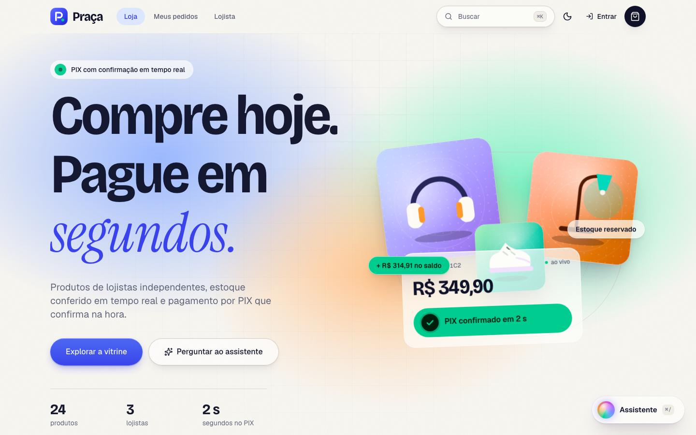

</div>

> Um projeto de estudo e portfólio. Ele nunca toca em dinheiro de verdade: o PIX roda contra um provedor de pagamento simulado atrás de uma porta, e os modelos de IA são simulados atrás de interfaces. Todo o resto é real e roda de ponta a ponta na sua máquina.

## Sumário

[Visão geral](#visão-geral) · [Tour pelo produto](#tour-pelo-produto) · [Arquitetura](#arquitetura) · [Como um pedido flui](#como-um-pedido-flui) · [Padrões de confiabilidade](#padrões-de-confiabilidade) · [Segurança](#segurança) · [Ciclo de vida do lojista](#ciclo-de-vida-do-lojista) · [Assistente de IA](#assistente-de-ia-rag-e-agente) · [Observabilidade](#observabilidade) · [Testes e qualidade](#testes-e-qualidade) · [Padrões e decisões](#padrões-e-decisões) · [Estrutura do repositório](#estrutura-do-repositório) · [Início rápido](#início-rápido) · [Documentação](#documentação) · [Limitações](#limitações-conhecidas)

## Visão geral

| | |
|---|---|
| **Serviços** | `ordering`, `payments`, `inventory`, `ledger`, `notifications`, `catalog`, `assistant`, `identity`, mais um API gateway. Cada um tem o seu banco e conversa com os outros por eventos. |
| **Consistência** | Outbox transacional, inbox idempotente, `Idempotency-Key`, saga coreografada com timeout global e reembolso de pagamento tardio, livro-razão de dupla entrada em centavos inteiros. |
| **Resiliência** | Circuit breaker, retry com full jitter e orçamento de retries, propagação de deadline, bulkhead, rate limit distribuído, filas de mensagens mortas. Provada por um script de caos que derruba serviços na stack real. |
| **Segurança** | JWT EdDSA com JWKS, refresh tokens rotativos com detecção de reuso, propagação de identidade assinada, autorização por objeto, isolamento entre lojistas, revogação de token. |
| **Observabilidade** | Um trace OpenTelemetry por pedido atravessando o Kafka (26 spans em 11 serviços, cerca de 650 ms), métricas RED, três dashboards no Grafana com alertas de burn rate de SLO. |
| **IA** | Recuperação híbrida (pgvector mais busca textual, fundidas com RRF), entendimento de consulta, cache semântico, agente com ferramentas, 41 ataques red team contidos, avaliação de 111 casos que barra o build. |
| **Qualidade** | Mais de 1.650 testes automatizados, 181 verificações de ponta a ponta na stack real, tipagem estrita em Python e TypeScript, 20 jobs de CI. |

## Tour pelo produto

<table>
<tr>
<td width="50%">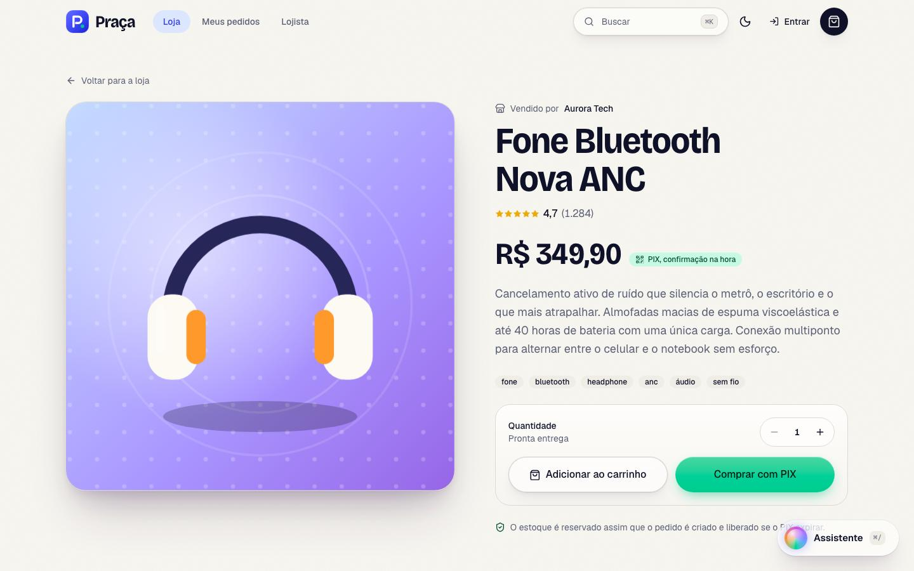<br><sub><b>Loja.</b> Arte de produto gerada (zero peso de imagem), estoque ao vivo, adicionar ao carrinho com animação do item voando.</sub></td>
<td width="50%">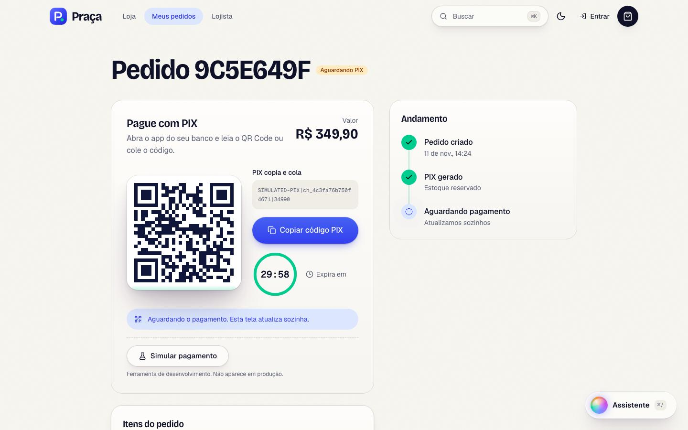<br><sub><b>Checkout PIX.</b> QR code, anel de contagem regressiva real e linha do tempo do pedido que atualiza conforme os eventos chegam.</sub></td>
</tr>
<tr>
<td>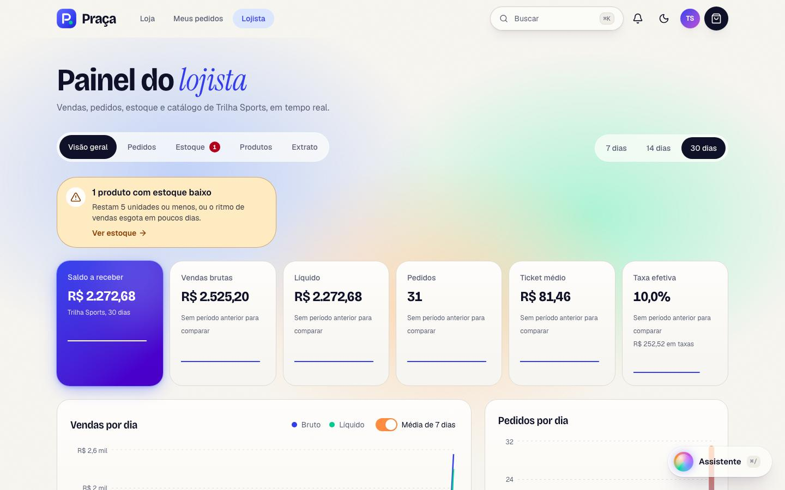<br><sub><b>Painel do lojista.</b> KPIs com variação contra o período anterior, média móvel e alertas acionáveis, alimentados pelo livro-razão de dupla entrada.</sub></td>
<td>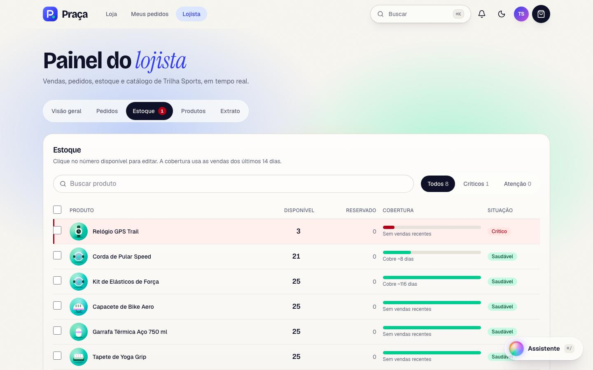<br><sub><b>Estoque.</b> Barras de cobertura pelo ritmo de vendas, edição inline com atualização otimista e rollback, itens críticos em primeiro.</sub></td>
</tr>
<tr>
<td>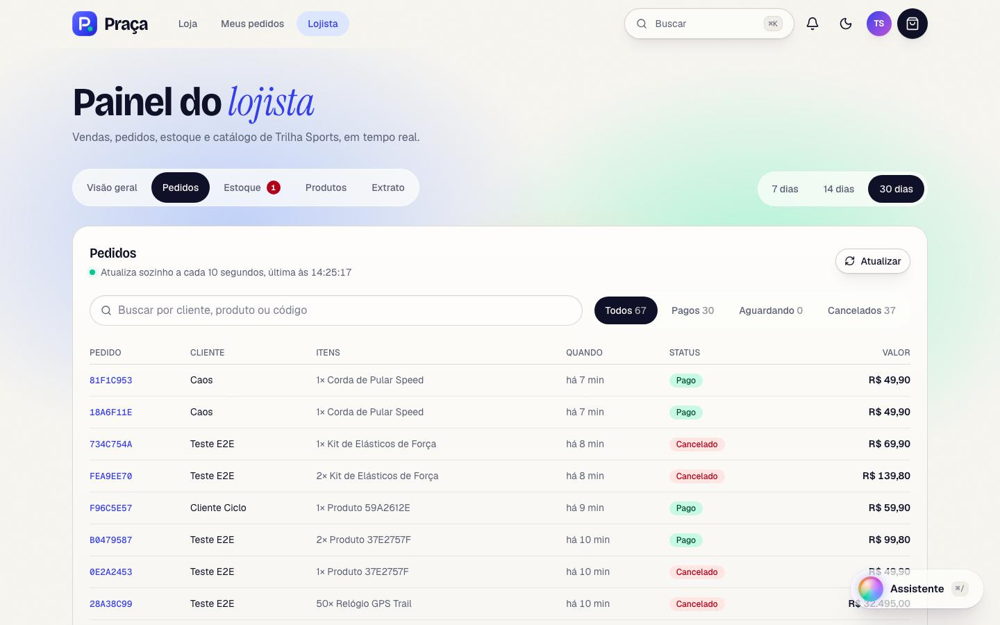<br><sub><b>Pedidos.</b> Fila ao vivo com filtros de status, gaveta de detalhes e um aviso quando uma venda entra.</sub></td>
<td><br><sub><b>Assistente.</b> Respostas em streaming com citações numeradas, cartões de produto e o rastro "como cheguei nessa resposta".</sub></td>
</tr>
</table>

<details>
<summary>Mais telas: aba de produtos, extrato, tema escuro, celular</summary>

<table>
<tr>
<td width="50%">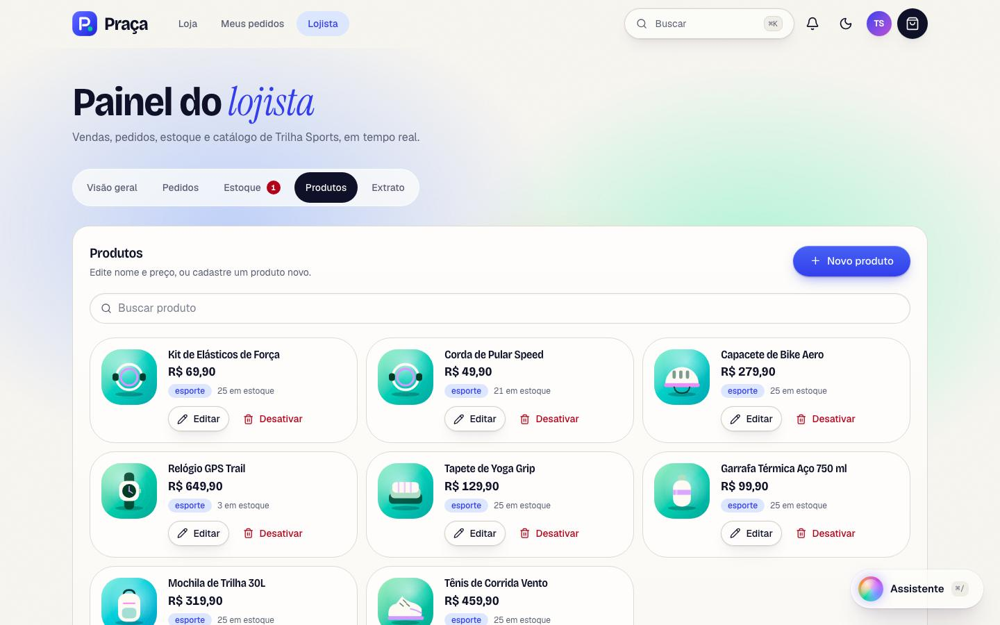</td>
<td width="50%">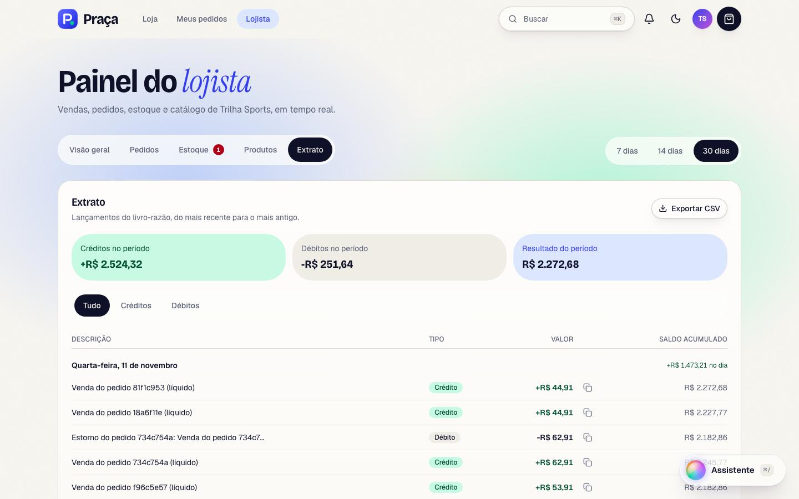</td>
</tr>
<tr>
<td>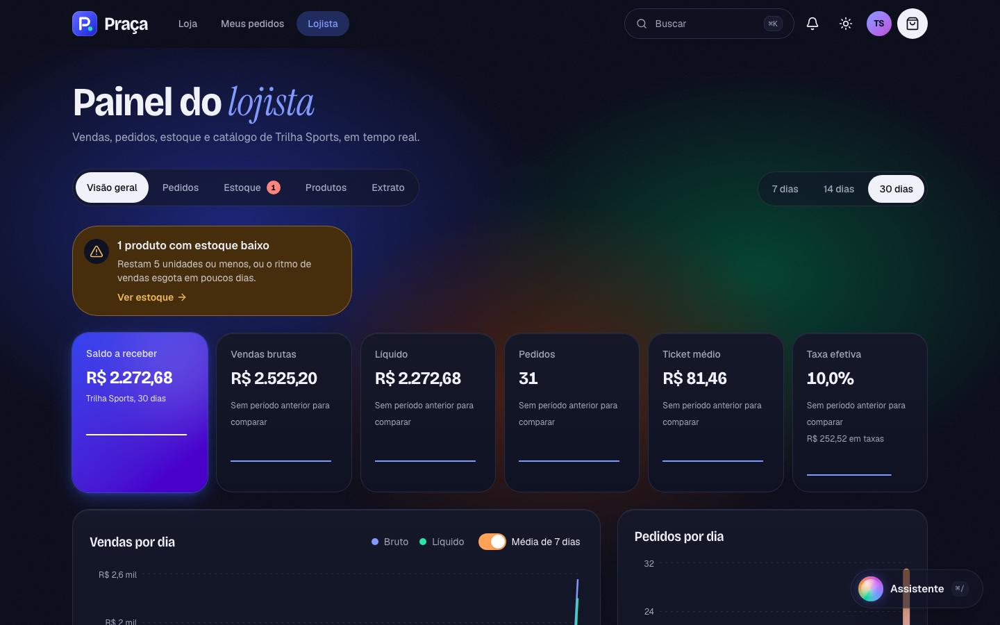</td>
<td align="center"></td>
</tr>
</table>

</details>

A loja é voltada ao Brasil, então os textos da interface são em português do Brasil. Código, comentários e documentação são em inglês.

## Arquitetura

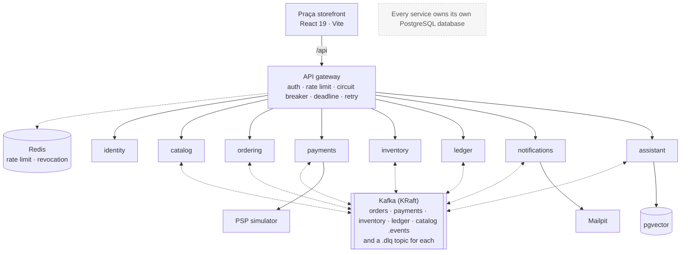

| Serviço | Porta | Responsabilidade | Padrões que exercita |
|---|---|---|---|
| `gateway` | 8000 | Ponto único de entrada: rotas, auth, rate limit, resiliência, saúde agregada | Reverse proxy, circuit breaker, bulkhead, propagação de deadline, streaming SSE |
| `identity` | 8008 | Cadastro, login, tokens, papéis | argon2id, JWT EdDSA e JWKS, rotação de refresh com detecção de reuso |
| `catalog` | 8003 | Produtos, busca, API de escrita do lojista | Busca sem acento, revalidação por ETag, publicador por outbox |
| `ordering` | 8001 | Pedidos e timeout da saga | Agregado DDD, Unit of Work, outbox, `Idempotency-Key`, process manager |
| `payments` | 8002 | Cobranças PIX, webhook do PSP, reembolsos | Inbox, webhook HMAC que reconsulta o PSP, fail-closed, cliente de PSP resiliente |
| `inventory` | 8004 | Estoque e reservas | Reserva tudo-ou-nada com TTL, `FOR UPDATE`, ordem determinística de locks |
| `ledger` | 8005 | Saldos e extratos dos lojistas | Dupla entrada, dinheiro em centavos inteiros, conciliação |
| `notifications` | 8006 | E-mails aos clientes | Celery com retry, sweeper, resumo diário |
| `assistant` | 8007 | Assistente de compras | RAG, recuperação híbrida, laço de agente, cache semântico, guardrails |
| `frontend` | 5173 | Loja e painel do lojista | TanStack Router e Query, Motion, MSW, Playwright |

O contrato de API, o catálogo de eventos, as portas e os dados de seed ficam em um só lugar: [`docs/pt-BR/CONTRATOS.md`](docs/pt-BR/CONTRATOS.md). As notas de desenho mais longas estão em [`docs/pt-BR/ARQUITETURA.md`](docs/pt-BR/ARQUITETURA.md).

## Como um pedido flui

Nenhum serviço é chamado de forma síncrona no caminho de escrita. O pedido é aceito em uma transação local e todo o resto reage a eventos.

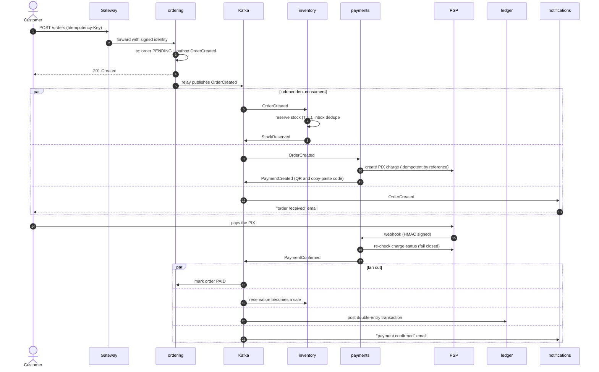

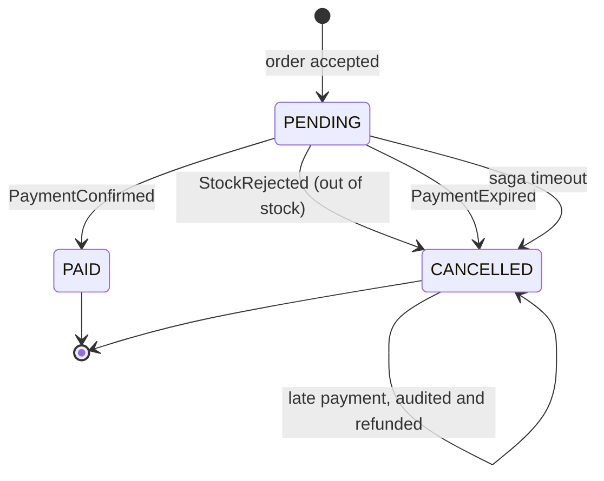

Os caminhos de falha compensam por eventos, em vez de transações distribuídas: uma rejeição de estoque cancela o pedido, o que cancela a cobrança pendente e libera a reserva. Um pagamento que chega depois de o pedido ter sido cancelado é registrado numa tabela de auditoria e reembolsado no PSP, estornado no ledger e devolvido ao estoque, tudo de forma idempotente. O timeout da saga cancela qualquer pedido preso em `PENDING`.

## Padrões de confiabilidade

### Outbox, inbox e idempotência

Não existe transação que cubra um banco de dados e um broker, então o sistema nunca tenta escrever nos dois.

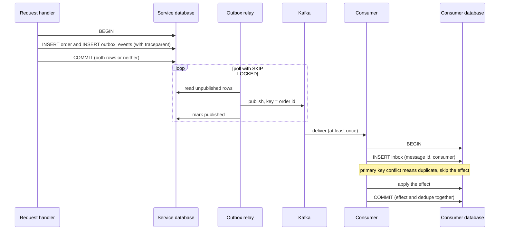

- **Outbox:** o evento é gravado na mesma transação do dado, e então um relay o publica. A linha carrega o `traceparent` do W3C, então os traces sobrevivem ao salto pelo Kafka.
- **Inbox:** os consumidores reivindicam `(message_id, consumer)` na mesma transação do efeito, então a reentrega é inofensiva.
- **`Idempotency-Key`:** reivindicada com `INSERT ... ON CONFLICT DO NOTHING` dentro da transação do pedido. Cinco requisições idênticas e concorrentes criam um pedido só (coberto por um teste de integração).
- **Mensagens venenosas:** os consumidores tentam um número limitado de vezes e depois enviam para `<tópico>.dlq` com o motivo e a origem. Uma ferramenta as reprocessa, em simulação por padrão, com proteção contra laço.
- **Evolução de eventos:** todo evento tem `schema_version`, um modelo por versão, upcasters e arquivos golden que quebram o build se um produtor mudar um formato sem querer. Veja [`docs/pt-BR/EVOLUCAO-DE-EVENTOS.md`](docs/pt-BR/EVOLUCAO-DE-EVENTOS.md).

### Sobrevivendo à falha de dependências

Toda chamada que o gateway faz a um upstream passa pelo mesmo pipeline.

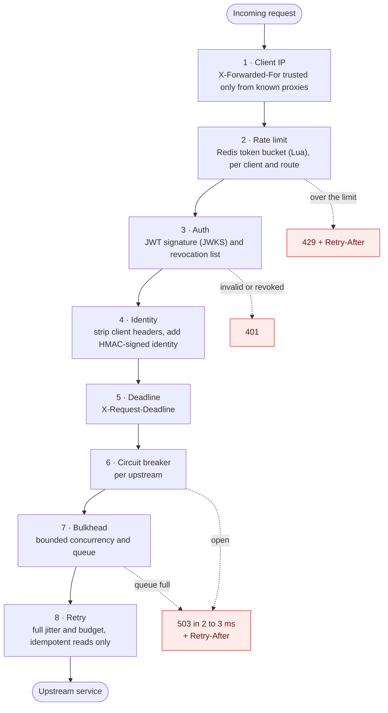

| Padrão | Contra o quê protege | Onde |
|---|---|---|
| Circuit breaker (janela deslizante, chamadas lentas, sondas no half-open) | Uma dependência doente consumindo todos os workers | Gateway por upstream, cliente do PSP, LLM e embedder |
| Retry com full jitter e orçamento de retries | Erros transitórios, sem tempestade de retries | Só leituras idempotentes e chamadas ao PSP |
| Propagação de deadline | Cadeias lentas que sobrevivem ao chamador | `X-Request-Deadline` respeitado salto a salto |
| Bulkhead | Uma dependência usando toda a concorrência | Gateway e cliente do PSP |
| Rate limit distribuído | Abuso, com um balde compartilhado entre réplicas | Gateway, mais login e cadastro |
| Degradação graciosa | Falha total quando uma parte cai | 503 estruturado, o assistente volta para busca simples |

O script de caos (`scripts/chaos.sh`) derruba `catalog`, `payments` e `redis` na stack real e verifica 40 coisas: o breaker abre, as respostas falham rápido, o sistema se recupera sozinho, e pedidos criados antes e durante a queda ainda chegam a `PAID`. Com o Redis fora, o gateway continuou respondendo (30 de 30 requisições, p50 de 12 ms). Detalhes e os equivalentes do Polly para quem vem do .NET estão em [`docs/pt-BR/RESILIENCIA.md`](docs/pt-BR/RESILIENCIA.md).

<table>
<tr>
<td width="50%">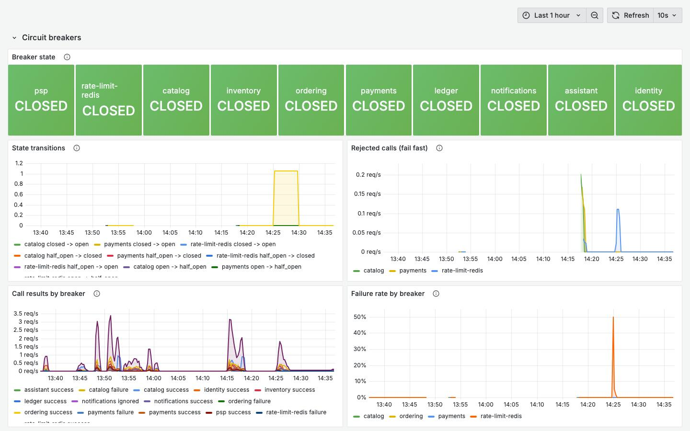<br><sub>Dashboard de resiliência: estado dos breakers, transições e rejeições rápidas durante o teste de caos.</sub></td>
<td width="50%">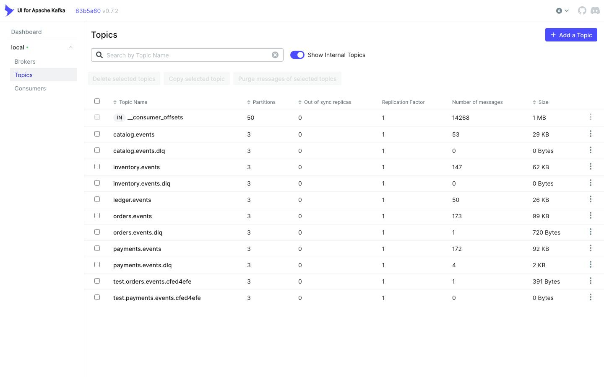<br><sub>Tópicos de eventos e suas filas de mensagens mortas no Kafka UI.</sub></td>
</tr>
</table>

## Segurança

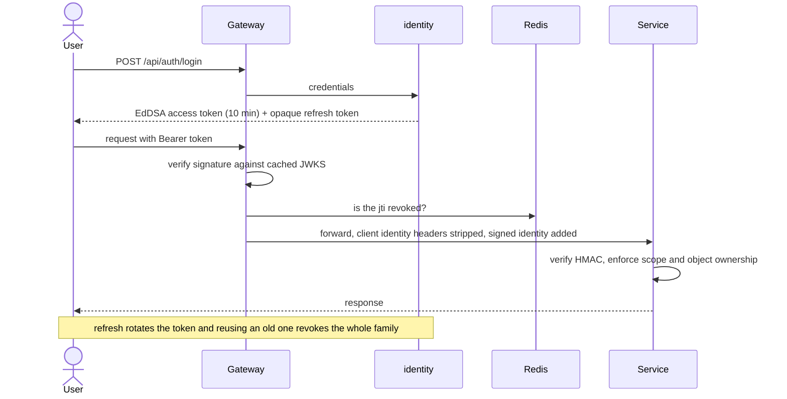

- **Identidade como serviço** (registro de decisão em [`docs/adr`](docs/pt-BR/adr/0001-identidade-como-servico.md)): o gateway só guarda a chave pública.
- **Anti-spoofing:** o gateway apaga qualquer header `X-User-*` enviado por um cliente e injeta uma identidade assinada por HMAC, presa ao id da requisição e a uma janela de 60 segundos, porque as portas dos serviços são acessíveis no host.
- **Autorização por objeto:** o pedido de outra pessoa responde `404`, igual a um inexistente, então a existência não vaza. Lojistas veem só o próprio ledger, estoque e pedidos, com testes de isolamento entre dois lojistas.
- **Controles de abuso:** backoff progressivo no login e no cadastro por IP e por e-mail, limite de tamanho do corpo, headers de segurança, revogação de token no logout e no reuso do refresh (efetiva em menos de um segundo).
- **Modelo de ameaças:** STRIDE e o OWASP API Top 10 mapeados para controles e testes concretos em [`docs/pt-BR/SEGURANCA.md`](docs/pt-BR/SEGURANCA.md), inclusive o que não é coberto.

## Ciclo de vida do lojista

O painel do lojista exercita o sistema inteiro, da criação do produto ao dinheiro no ledger, e um script de ponta a ponta verifica cada passo.

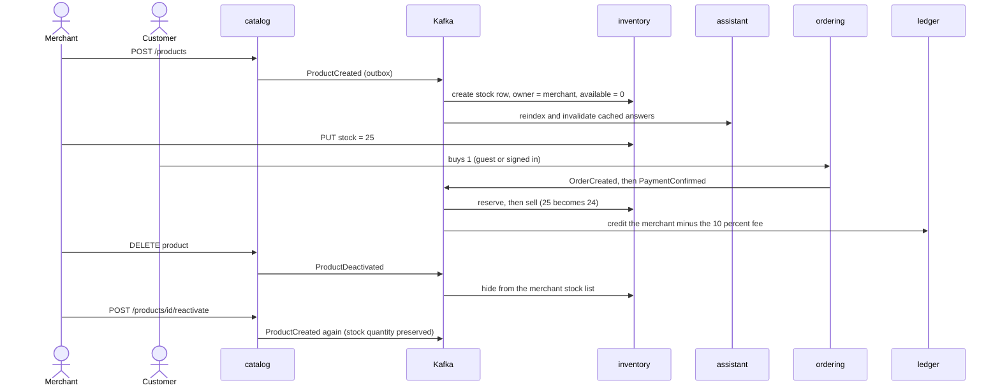

As leituras do catálogo revalidam a cada requisição (ETag, `max-age=0, must-revalidate`) e a lista do dono é `no-store`, então uma edição, um produto novo ou uma desativação aparece na hora. Isso foi descoberto do jeito difícil: o `curl` não tem cache, um navegador tem.

## Assistente de IA (RAG e agente)

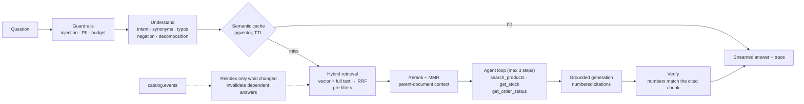

A avaliação roda num conjunto dourado de 111 casos (adversariais, negação, erros de digitação, multi-hop, holdout) e um portão de regressão no CI quebra o build quando uma métrica cai abaixo do limiar.

| Métrica | Baseline | Pipeline de produção |
|---|---|---|
| hit@3 | 0,923 | **0,962** |
| MRR | 0,870 | **0,952** |
| nDCG@5 | 0,861 | **0,942** |
| Negação ("sem X") tratada | 0,000 | **1,000** |
| Taxa de acerto do cache semântico | n/d | 75% em 107 perguntas |
| Ataques red team contidos | n/d | 41 de 41 |

> Ressalva honesta: os embeddings são baseados em hashing e o LLM é determinístico, então esses números são uma rede de regressão para a qualidade da recuperação, não uma afirmação sobre a qualidade de um modelo. Os adaptadores Ollama estão implementados e testados contra um servidor falso. Veja [`docs/pt-BR/RAG-EXPLICADO.md`](docs/pt-BR/RAG-EXPLICADO.md) (com 15 perguntas de entrevista) e [`docs/pt-BR/RAG-AVALIACAO.md`](docs/pt-BR/RAG-AVALIACAO.md).

## Observabilidade

<table>
<tr>
<td width="50%">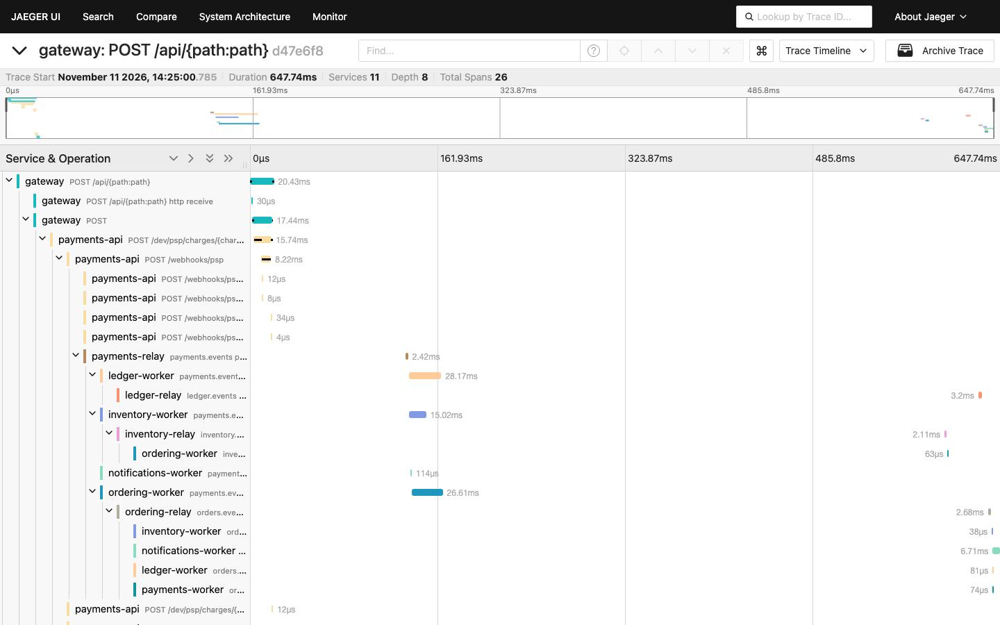<br><sub>Um trace por pedido: 26 spans em 11 serviços em 648 ms, atravessando o Kafka pelo <code>traceparent</code> armazenado.</sub></td>
<td width="50%">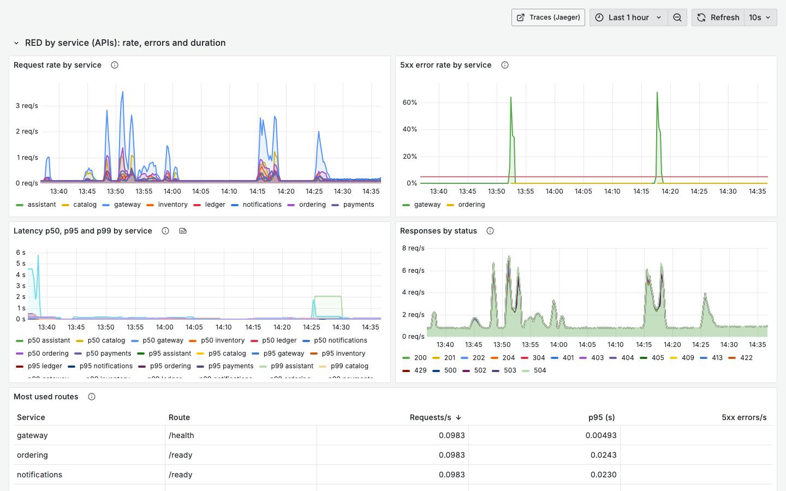<br><sub>Métricas RED por serviço, duração dos handlers, DLQ e backlog do outbox.</sub></td>
</tr>
<tr>
<td>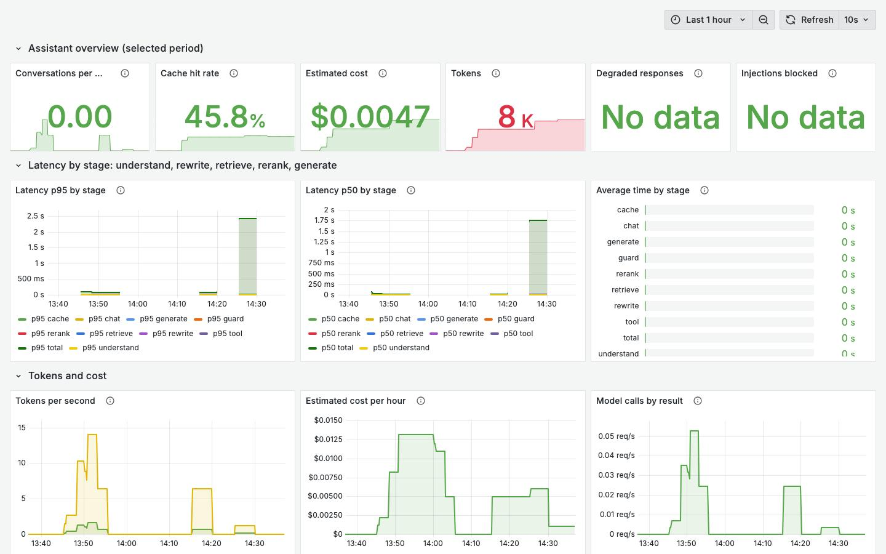<br><sub>Assistente: latência por etapa, tokens e custo estimado, taxa de acerto do cache.</sub></td>
<td>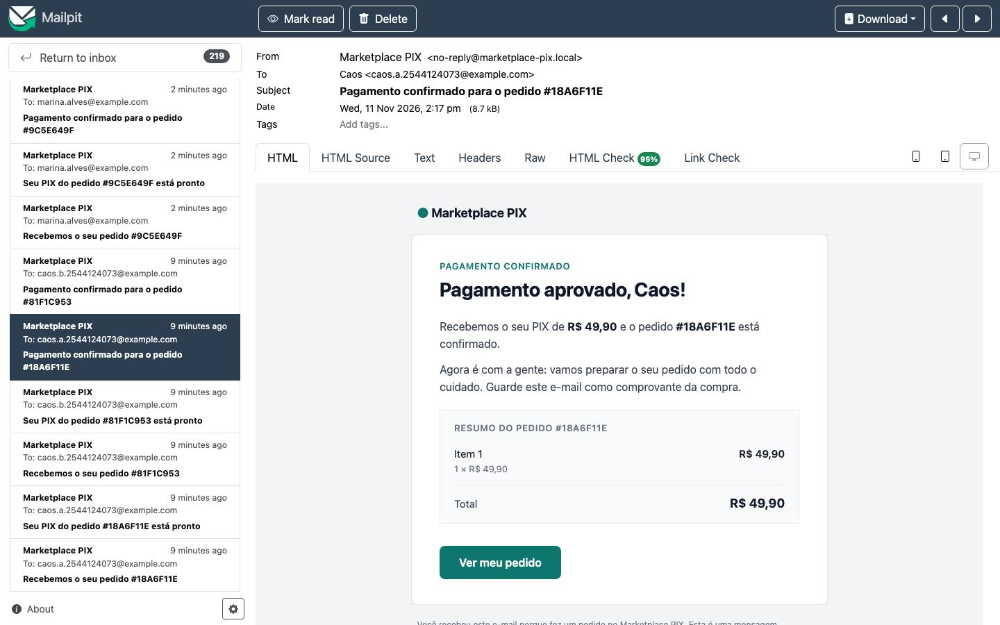<br><sub>E-mails transacionais enviados pelo Celery, capturados pelo Mailpit.</sub></td>
</tr>
</table>

Os logs são JSON estruturado com `trace_id`. As métricas são Prometheus (RED mais contadores de negócio). Os alertas incluem regras de burn rate de SLO verificadas com `promtool test rules`.

## Testes e qualidade

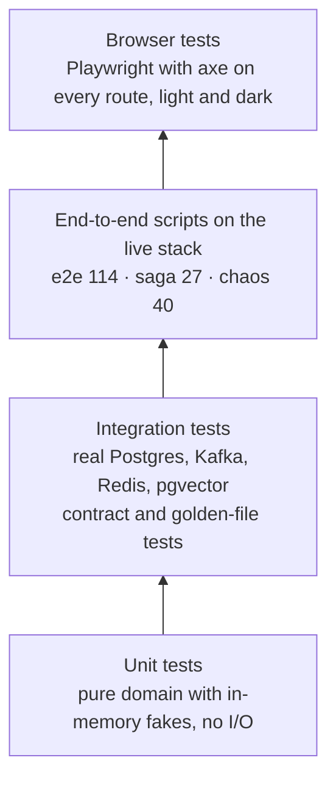

| Camada | O quê | Quantidade |
|---|---|---|
| Backend unitário e integração | 9 serviços Python mais uma biblioteca compartilhada, ruff, mypy estrito | 1.425 |
| Frontend unitário | Vitest, Testing Library, MSW | 172 |
| Frontend ponta a ponta | Playwright com axe (WCAG), movimento reduzido, todas as abas do lojista | 60 |
| Scripts na stack real | `scripts/e2e.sh` (auth, IDOR, isolamento entre lojistas, ciclo de vida do lojista, idempotência), `scripts/e2e-saga.sh` (pagamento que nunca chega, pagamento tardio reembolsado), `scripts/chaos.sh` | 181 verificações |
| Teste de carga | `scripts/loadtest.py`, resultados em [`docs/pt-BR/loadtest-result.md`](docs/pt-BR/loadtest-result.md) | n/d |

Práticas que importam mais que as contagens:

- **Testes primeiro para as partes difíceis:** concorrência (100 reservas para 10 unidades aceitam exatamente 10, 50 pagamentos simultâneos mantêm o ledger exato, um teste de propriedade confere que os livros sempre fecham), idempotência e todo caminho de falha.
- **Contratos são testados, não presumidos:** arquivos golden por versão de evento, testes de compatibilidade dos consumidores e uma fonte única da verdade para rotas e eventos.
- **Teste instável é bug:** asserções que entendem animação, timeouts assíncronos generosos e uma rodada de estresse da suíte inteira em paralelo antes de confiar num verde.
- **Mocks não provam contratos:** vários bugs de integração só apareceram contra o backend real (um `warning: null` que o mock nunca enviava, um id de convidado que o servidor rejeitou corretamente, uma chamada de reembolso sem proteção). Toda integração agora roda os três scripts na stack real e uma passada em navegador real.
- **CI:** 20 jobs por push.

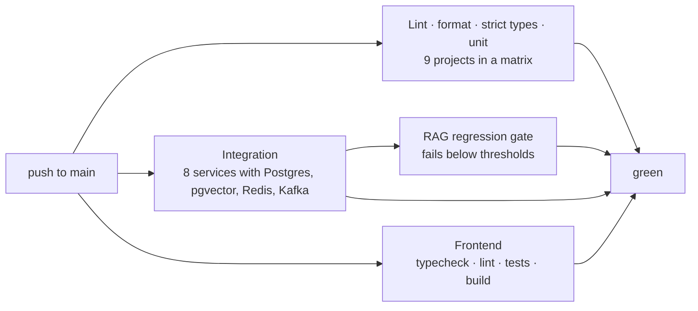

## Padrões e decisões

| Padrão ou decisão | Onde | Por quê |
|---|---|---|
| Clean Architecture, portas e adaptadores (`Protocol`) | Todos os serviços | O domínio não importa framework e é testado com fakes em memória |
| Agregados e value objects de DDD | `ordering`, `payments`, `inventory` | As invariantes vivem em um lugar só (por exemplo `Money` em centavos, sem floats) |
| Unit of Work | Todos os serviços | Uma transação por caso de uso |
| Outbox transacional e inbox idempotente | Produtores e consumidores | Eventos confiáveis sem transações distribuídas |
| Saga coreografada com process manager para prazos | Fluxo do pedido | Baixo acoplamento, com visibilidade pelos traces distribuídos |
| Lock pessimista com ordem determinística | `inventory`, `ordering` | Sem deadlock, sem venda em excesso |
| Microsserviços com banco por serviço | Sistema todo | Praticar problemas distribuídos reais. Uma equipe pequena começaria com um monólito modular e extrairia por necessidade |
| Kafka em vez de uma fila simples | Barramento de eventos | Replay, ordem por chave, vários consumidores |
| Identidade como serviço próprio | `identity` | Isola credenciais e chaves ([ADR 0001](docs/pt-BR/adr/0001-identidade-como-servico.md)) |
| Fail-closed | Webhook, auth do gateway | Na dúvida, nega e deixa pendente em vez de aprovar |
| Composition root no `main.py` | Todos os serviços | Injeção de dependência manual, fácil de ler e testar |

## Estrutura do repositório

```text
marketplace-pix/
├── backend/
│   ├── gateway/                  reverse proxy: auth, rate limit, resiliência
│   ├── libs/marketplace_common/  consumidor + DLQ, outbox relay, resiliência, segurança, observabilidade
│   └── services/
│       ├── ordering/ payments/ inventory/ ledger/
│       └── notifications/ catalog/ assistant/ identity/
├── frontend/                     loja e painel do lojista em React
├── infra/                        docker compose, stack de observabilidade (Prometheus, Grafana, Jaeger)
├── scripts/                      up.sh · e2e.sh · e2e-saga.sh · chaos.sh · loadtest.py · reset.sh
├── docs/                         arquitetura, contratos, segurança, resiliência, RAG (inglês), pt-BR/ (português)
└── .github/workflows/ci.yml
```

Dentro de cada serviço, as dependências só apontam para dentro:

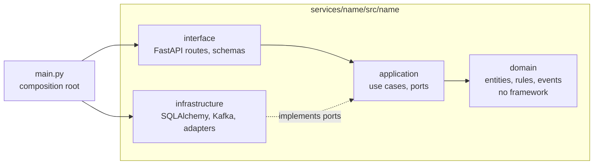

## Início rápido

Pré-requisitos: Docker com cerca de 8 GB de memória disponíveis. Para rodar as suítes de teste você também precisa do [uv](https://docs.astral.sh/uv/) e do [pnpm](https://pnpm.io/).

```bash
git clone https://github.com/hengtan/marketplace-pix.git
cd marketplace-pix
scripts/up.sh --obs        # constrói e sobe tudo, depois espera o gateway ficar saudável
scripts/e2e.sh             # 114 verificações na stack real
```

| O quê | URL |
|---|---|
| Loja | http://localhost:5173 |
| Documentação da API (gateway) | http://localhost:8000/docs |
| Painel do lojista | http://localhost:5173/lojista |
| Mailpit (e-mails) | http://localhost:8025 |
| Kafka UI | http://localhost:8081 |
| Jaeger (traces) | http://localhost:16686 |
| Grafana (dashboards) | http://localhost:3000 (admin / admin) |

**Contas de desenvolvimento** (criadas pelo seed, só para desenvolvimento): `trilha-sports@marketplace-pix.local`, `aurora-tech@marketplace-pix.local`, `casa-lume@marketplace-pix.local` (lojistas) e `admin@marketplace-pix.local`, todas com a senha `praca1234`. Clientes também podem comprar como convidados ou se cadastrar em `/cadastro`.

| Script | Finalidade |
|---|---|
| `scripts/up.sh [--obs]` | Cria o `.env`, constrói, sobe, espera a saúde (`--obs` adiciona Prometheus, Grafana, Jaeger) |
| `scripts/e2e.sh` | Auth, IDOR, isolamento entre lojistas, compra, idempotência, ciclo de vida do lojista |
| `scripts/e2e-saga.sh` | Pagamento que nunca chega, pagamento tardio reembolsado (rode com `SAGA_TIMEOUT_SECONDS=12 SAGA_SWEEP_INTERVAL_SECONDS=3`) |
| `scripts/chaos.sh` | Derruba catalog, payments e Redis e depois verifica a recuperação |
| `scripts/loadtest.py` | Teste de carga assíncrono com p50, p95, p99 e taxa de 429 |
| `scripts/reset.sh` | Apaga os volumes e começa limpo |

Rodar os testes de um serviço:

```bash
cd backend/services/ordering && uv run pytest        # unitários + integração (precisa dos containers de infra)
cd frontend && pnpm install && pnpm test && pnpm e2e  # unitários, depois Playwright com mocks
```

## Documentação

| Documento | Conteúdo |
|---|---|
| [`docs/pt-BR/ARQUITETURA.md`](docs/pt-BR/ARQUITETURA.md) | Fluxos, saga, padrões, tabelas principais, Clean Architecture |
| [`docs/pt-BR/CONTRATOS.md`](docs/pt-BR/CONTRATOS.md) | Portas, contratos REST, catálogo de eventos, matriz de acesso, dados de seed |
| [`docs/pt-BR/RESILIENCIA.md`](docs/pt-BR/RESILIENCIA.md) | Cada padrão, quando usar, trade-offs, resultados de caos e carga |
| [`docs/pt-BR/SEGURANCA.md`](docs/pt-BR/SEGURANCA.md) | Modelo de ameaças (STRIDE), mapeamento do OWASP API Top 10, limitações |
| [`docs/pt-BR/EVOLUCAO-DE-EVENTOS.md`](docs/pt-BR/EVOLUCAO-DE-EVENTOS.md) | Versionamento, upcasters, arquivos golden |
| [`docs/pt-BR/RAG-EXPLICADO.md`](docs/pt-BR/RAG-EXPLICADO.md) · [`docs/pt-BR/RAG-AVALIACAO.md`](docs/pt-BR/RAG-AVALIACAO.md) | O pipeline, por que cada técnica existe, resultados medidos |
| [`docs/pt-BR/loadtest-result.md`](docs/pt-BR/loadtest-result.md) | Método e resultados do teste de carga |
| [`docs/pt-BR/ROADMAP.md`](docs/pt-BR/ROADMAP.md) | O que está entregue e o que não está |
| [`frontend/docs/pt-BR/DESIGN.md`](frontend/docs/pt-BR/DESIGN.md) | Identidade visual, movimento, desempenho, acessibilidade |
| READMEs dos serviços | [`assistant`](backend/services/assistant/README.pt-BR.md) · [`marketplace_common`](backend/libs/marketplace_common/README.pt-BR.md) · [`frontend`](frontend/README.pt-BR.md) |

A documentação principal é em inglês, e todo documento tem uma tradução em português (Brasil) em uma pasta `pt-BR` ou ao lado como `README.pt-BR.md`, linkada na primeira linha de cada arquivo.

## Limitações conhecidas

Ditas com clareza, porque saber o que falta faz parte do trabalho. A lista completa está em [`docs/pt-BR/ROADMAP.md`](docs/pt-BR/ROADMAP.md).

- Os modelos de IA são simulados. O pipeline, a avaliação e os guardrails são reais; trocar por Ollama ou um modelo hospedado é o próximo passo.
- O PSP é simulado atrás de uma porta. Uma integração real precisa de credenciais de sandbox e conciliação diária.
- Ainda sem Azure, Terraform, Kubernetes ou Helm. Tudo roda em Docker Compose.
- Sem MFA nem verificação de e-mail, e o refresh token viaja no corpo da resposta (a resposta de produção é um cookie `HttpOnly` atrás de um BFF).
- O Lighthouse mobile fica entre 88 e 91 sob um 4G lento simulado e CPU 4x mais lenta. No desktop é 99.
- O estado do circuit breaker é por processo, a menos que o modo compartilhado opcional seja ligado.

---

<div align="center"><sub>Engineering by <a href="https://mocktstudio.com">MocktStudio</a></sub></div>
